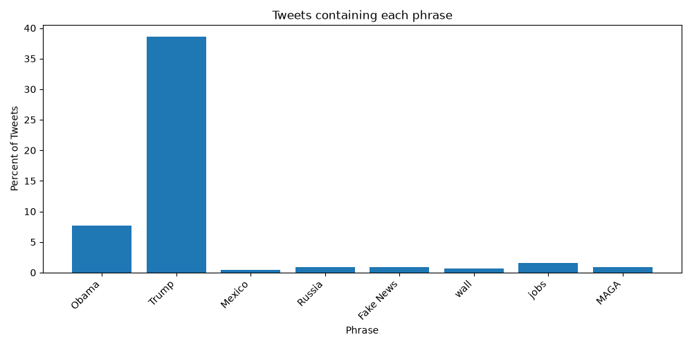

# [lab-web-data](https://csci40.rtealwitter.com/topics/05_web_scraping/lab.html)

This table and bar chart show the percent of tweets in the 2009-2018 archive for each keyword, ignoring capitalization.

| Phrase             | Percent of Tweets |
|------------------ | -----------------|
|              Obama | 07.73 |
|              Trump | 38.58 |
|             Mexico | 00.45 |
|             Russia | 00.91 |
|          Fake News | 00.88 |
|               wall | 00.68 |
|               jobs | 01.59 |
|               MAGA | 00.93 |

